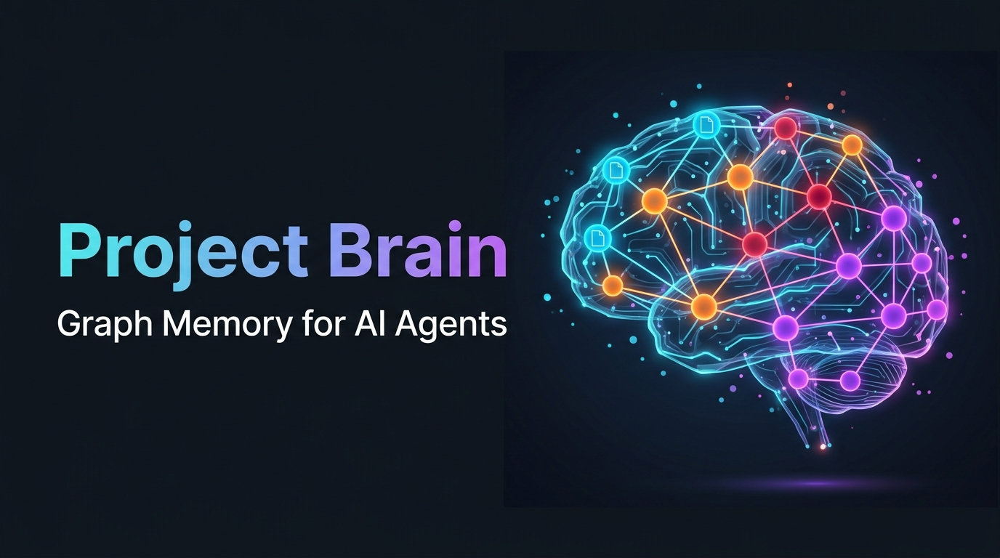
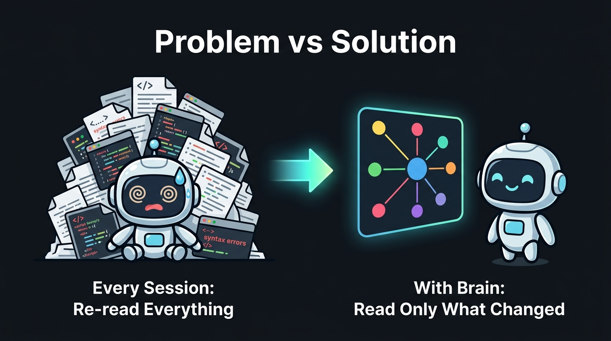
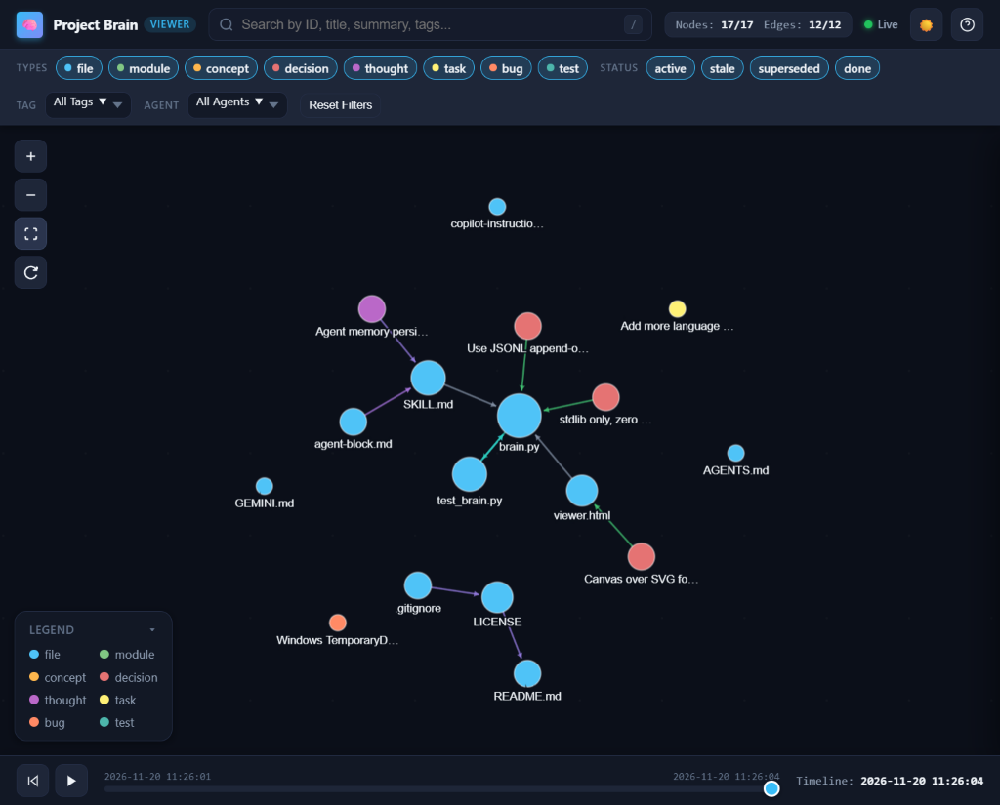
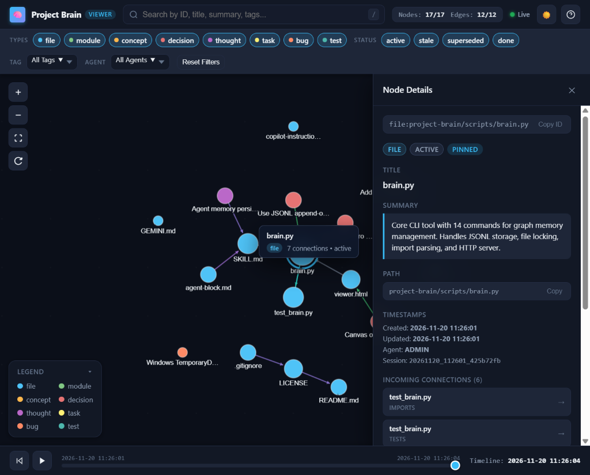
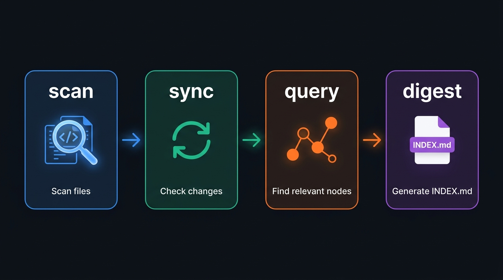

<p align="center">
  
</p>

<p align="center">
  <strong>Persistent graph memory for AI coding agents. Stop re-reading entire repositories every session.</strong>
</p>

<p align="center">
  <a href="#why-project-brain"></a>
  <a href="#requirements"></a>
  <a href="#dependencies"></a>
  <a href="#tests"></a>
  <a href="#platforms"></a>
  <a href="LICENSE"></a>
</p>

---

## 💡 Why Project Brain?

Every time an AI coding agent (Antigravity, Codex, Copilot, Claude Code) opens a project or starts a new session, it faces the same bottleneck: **re-reading files repeatedly**, blowing through context limits, and burning through API tokens without remembering architectural decisions made minutes or days ago.

<p align="center">
  
</p>

**Project Brain** equips your project with an append-only, Git-friendly knowledge graph stored directly in `.brain/`. The agent summarizes files, links dependencies, and records thoughts & decisions. On subsequent sessions, the agent **never scans the whole repository**: it reads a tiny digest (`INDEX.md`, $\le$ 2,000 tokens) and only inspects files flagged as **stale** or **new**.

---

## 🎨 Interactive Visual Graph Viewer

Curious about how your AI models the structure and design of your project? Run `brain serve` to explore the live interactive network in your browser.

<p align="center">
  
</p>

<p align="center">
  
</p>

### Viewer Highlights:
- **100% Self-Contained:** Single HTML file (`assets/viewer.html`), no CDN, no external frameworks, no npm dependencies.
- **High-Performance Canvas Rendering:** Spatial-grid force-directed simulation capable of smoothly displaying 1,000+ nodes and edges.
- **Deep Exploration:** Real-time search, multi-type filtering (files, decisions, thoughts, tasks, bugs), timeline playback slider, and neighbor spotlight on double-click.
- **Live Incremental Polling:** Seamlessly updates within 1.5 seconds when agents record new nodes, without resetting camera position or physics layout.
- **Adaptive Dark / Light Theme:** Follows system preference with GitHub-inspired styling.

---

## 🔄 Core Workflow Pipeline

Project Brain simplifies agent operations into a 4-stage feedback loop:

<p align="center">
  
</p>

1. **`scan`**: Walk project respecting `.gitignore` and parse imports across Python, JS/TS, HTML, and PHP into directed relationships.
2. **`sync`**: Hash contents against saved SHA1 values. Report **only** files modified or added since last check.
3. **`query`**: Token-matching with graph-proximity topological boost. Delivers a compact text subgraph so the agent rarely opens raw files.
4. **`digest`**: Generates a distilled `.brain/INDEX.md` prioritized by degree centrality, recency, open tasks, and active decisions ($\le$ 2,000 tokens).

---

## 🚀 Quick Start

### 1. Installation

Copy the `project-brain/` directory into your project root or skill directory:

```bash
# Recommended locations by AI tool
.agents/skills/project-brain/       # Antigravity
.agent/skills/project-brain/        # Codex
.github/skills/project-brain/       # GitHub Copilot
.claude/skills/project-brain/       # Claude Code
```

### 2. Initialize in Your Project

Run from your project root:

```bash
# Initialize .brain/ and inject instruction blocks into AGENTS.md, GEMINI.md, copilot-instructions.md
python project-brain/scripts/brain.py init

# Scan codebase to index files and dependencies
python project-brain/scripts/brain.py scan

# Generate the initial agent digest summary
python project-brain/scripts/brain.py digest

# (Optional) Open the live graph viewer
python project-brain/scripts/brain.py serve --port 8765
```

---

## 🧩 Supported AI Coding Agents

`project-brain` is strictly **agent-agnostic**. It requires no special APIs, interacting entirely via CLI commands, `SKILL.md`, and markdown instruction blocks.

| Agent / Environment | Location | Setup Method |
|---|---|---|
| **Antigravity** | `.agents/skills/project-brain/` | Auto-detected via `SKILL.md` |
| **Codex** | `.agent/skills/project-brain/` | Auto-configured via `AGENTS.md` |
| **VS Code Copilot** | `.github/skills/project-brain/` | Auto-configured via `.github/copilot-instructions.md` |
| **Claude Code** | `.claude/skills/project-brain/` | Auto-configured via `AGENTS.md` |
| **Cursor / Others** | Any folder in repo | Point agent to `SKILL.md` or run `init` |

---

## 🛠️ CLI Command Reference

All commands support the `--json` flag for structured agent consumption and exit code `!= 0` on error.

| Command | Description |
|---|---|
| `init` | Initialize `.brain/`, `config.json`, and inject idempotent agent rules into documentation files. |
| `doctor` | Self-diagnostic check: Python version $\ge$ 3.10, file permissions, stale lock detection, marker integrity. |
| `scan` | Scan project files, generate file nodes, and extract import edges using native AST & regex parsers. |
| `sync` | Compare stored SHA1 with current disk state; output **only** stale/new/deleted files. |
| `touch <path> --summary "..."` | Update a file node's summary and mark active with current SHA1 hash. |
| `note --type <type> --title "..."` | Record a thought, decision, task, or bug linked to existing nodes. |
| `link <src> <dst> --type <type>` | Create a directed relation edge (`imports`, `depends_on`, `implements`, `tests`, etc.). |
| `unlink <src> <dst>` | Remove an edge relation between two nodes. |
| `query <keywords>` | Graph-proximity boosted search; returns compact text subgraph. |
| `digest` | Compile `.brain/INDEX.md` within strict budget ($\le$ 2,000 tokens $\approx$ 8,000 chars). |
| `compact` | De-duplicate append-only JSONL logs and rewrite atomically with latest states. |
| `lint` | Check for orphan nodes, dangling edges, empty summaries, and stale locks. |
| `serve [--port 8765]` | Start local HTTP server bound exclusively to `127.0.0.1` serving viewer & `/api/graph`. |

---

## 📂 Storage & Data Architecture

All project state lives inside `.brain/` at the project root:

```text
.brain/
├── nodes.jsonl      # Append-only node records (last-write-wins)
├── edges.jsonl      # Append-only edge records
├── INDEX.md         # Generated digest read by agents at session start
├── config.json      # Ignore globs, token limits, language parser flags
└── *.lock           # Cross-platform atomic file locks (automatically gitignored)
```

### Key Principles:
- **Git-Friendly:** JSONL records are append-only with stable key ordering, producing clean diffs without merge nightmares.
- **Concurrency-Safe:** Cross-platform atomic locks (`msvcrt` on Windows, `fcntl` on POSIX) with 60-second stale lock auto-recovery.
- **Zero Dependencies:** Pure Python 3.10+ standard library (`pathlib`, `ast`, `json`, `hashlib`, `http.server`, `urllib`).

---

## 🧪 Testing & Validation

The test suite in `project-brain/scripts/test_brain.py` executes **69 tests across 12 categories** without external test runners:

```bash
# Run using Python stdlib unittest:
python -m unittest project-brain/scripts/test_brain.py

# Or with pytest:
pytest project-brain/scripts/test_brain.py -v
```

```text
============================= 69 passed in 34.72s =============================
```

- ✅ **Parsers**: Python AST, JS/TS ESM & CommonJS, HTML tags, PHP includes.
- ✅ **Concurrency**: Thread-safe atomic file writes and lock contention timeouts.
- ✅ **Integrity**: Idempotent initialization, orphan detection, and graph-proximity query scoring.
- ✅ **Integration**: 30-file multi-language simulated project lifecycle verification.

---

## 📄 License

Distributed under the [MIT License](LICENSE). Built for developers and autonomous agents alike.
