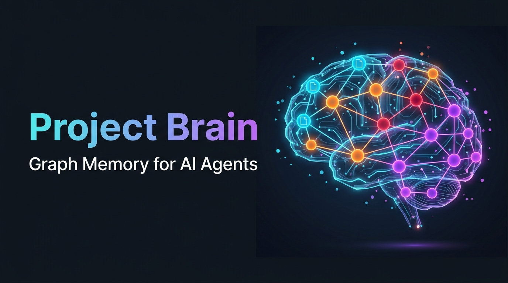
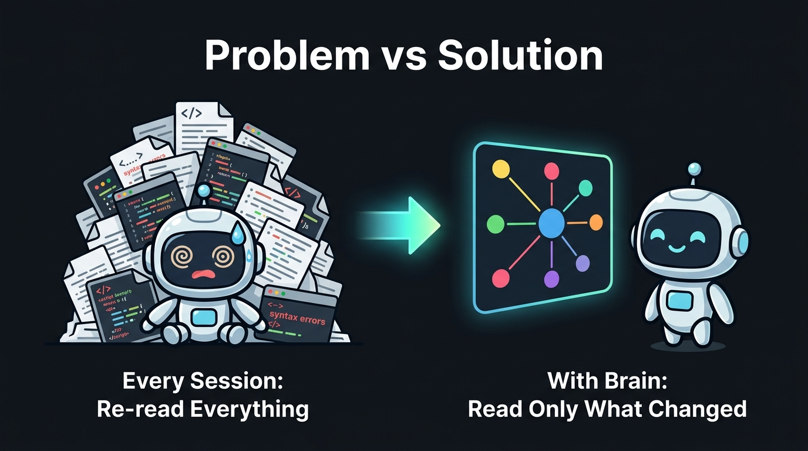
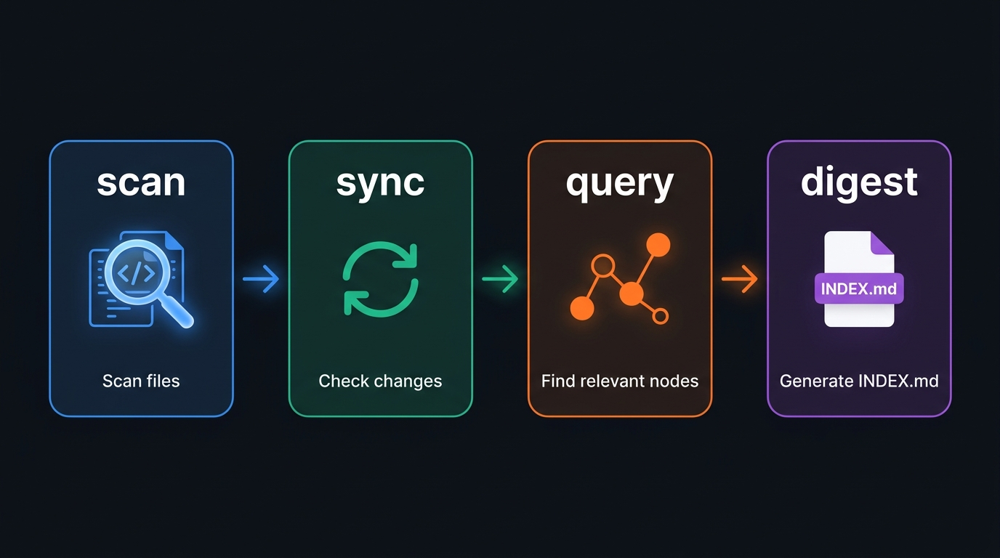
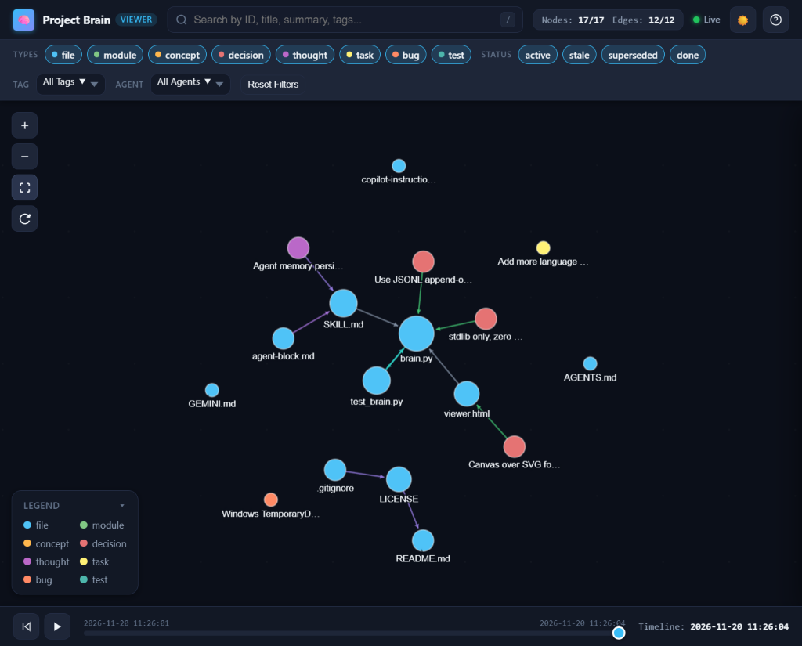

# project-brain

<p align="center">
  
</p>

Persistent graph memory for AI coding agents. Keeps a summarized knowledge graph in `.brain/` so agents don't re-read the entire codebase each session.

<p align="center">
  
</p>

## Quick Start

### 1. Kiểm tra môi trường

Project Brain chỉ cần Python 3.10+; không cần cài dependency bằng pip.

```powershell
python --version
```

### 2. Đặt skill vào dự án

Có thể giữ nguyên thư mục repository hoặc copy `project-brain/` vào thư mục gốc của dự án cần theo dõi:

```text
your-project/
├── project-brain/
│   ├── SKILL.md
│   ├── scripts/brain.py
│   └── assets/agent-block.md
└── ...
```

### 3. Khởi tạo

Chạy tất cả lệnh dưới đây từ thư mục gốc của **dự án**, không chạy từ thư mục `project-brain/`:

```powershell
python project-brain/scripts/brain.py init
python project-brain/scripts/brain.py scan
python project-brain/scripts/brain.py digest
python project-brain/scripts/brain.py doctor
```

`init` tạo `.brain/` và thêm instruction block vào các file hướng dẫn agent. `scan` xây dựng graph ban đầu. `digest` tạo `.brain/INDEX.md`. `doctor` xác nhận cấu hình đã khỏe.

Xem trước thay đổi mà không ghi file:

```powershell
python project-brain/scripts/brain.py init --dry-run
```

Chỉ khởi tạo dữ liệu, không thay instruction file:

```powershell
python project-brain/scripts/brain.py init --no-instruction-injection
```

## Workflow Pipeline

<p align="center">
  
</p>

## Install Location by Tool

| Tool | Copy `project-brain/` to | Auto-discovered |
|---|---|---|
| Antigravity | `.agents/skills/project-brain/` or `.gemini/skills/project-brain/` | ✅ via SKILL.md |
| Codex | `.agent/skills/project-brain/` | ✅ via AGENTS.md block |
| VS Code Copilot | `.github/skills/project-brain/` | ✅ via copilot-instructions.md block |
| Claude Code | `.claude/skills/project-brain/` | ✅ via AGENTS.md block |
| Any other | Anywhere; point agent to `SKILL.md` | Manual |

## Commands

| Command | Description |
|---|---|
| `init` | Create `.brain/`, inject agent instructions into AGENTS.md / GEMINI.md / copilot-instructions.md |
| `scan` | Walk project files, create/update file nodes, extract import edges |
| `sync` | Compare stored sha1 with disk; report stale/new/deleted files |
| `touch <path>` | Update a file node's summary and sha1 |
| `note` | Add a thought, decision, bug, or task node |
| `link` / `unlink` | Add or remove edges between nodes |
| `query <keywords>` | Search nodes by keyword; return relevant subgraph |
| `digest` | Generate `.brain/INDEX.md` (≤ 2000 tokens) |
| `compact` | Merge duplicate JSONL records |
| `lint` | Check for orphan nodes, dangling edges, empty summaries |
| `doctor` | Verify setup: Python version, permissions, paths, stale locks |
| `serve` | Start local viewer at http://127.0.0.1:8765 |

All commands support `--json` for machine-readable output.

## Visual Graph Viewer

<p align="center">
  
</p>

```bash
python path/to/project-brain/scripts/brain.py serve --port 8765
# Open http://127.0.0.1:8765
```

Interactive force-directed graph with search, filtering, timeline, and live updates.

## Data Files

Stored in `.brain/` at project root:
- `nodes.jsonl` — one node per line (append-only)
- `edges.jsonl` — one edge per line (append-only)
- `INDEX.md` — generated digest for agent consumption
- `config.json` — ignore globs, max_tokens, language parse settings
- `*.lock` — temporary lock files (gitignored)

## Requirements

- Python 3.10+ (stdlib only, no pip install)
- Works on Windows 11, macOS, Linux

